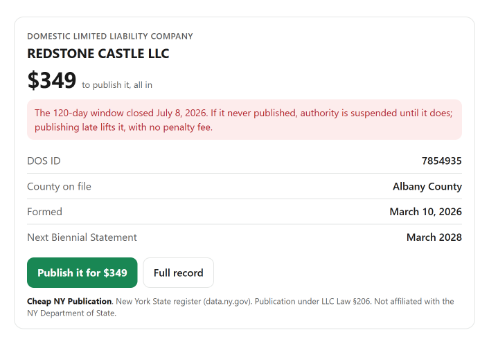

# Cheap NY Publication MCP server

Ask your AI assistant about any New York LLC: its publication deadline, the county on file, what publication costs, whether a new name is free, and what forming an LLC or filing a Biennial Statement, DBA or Certificate of Good Standing costs. Answers come from New York State's live business register (Department of State data on data.ny.gov) and [Cheap NY Publication](https://cheapnypublication.com)'s real prices.

It is a remote MCP server. No account, no API key, nothing to install or run.

```
https://cheapnypublication.com/mcp
```



## Add it to your assistant

**Claude.** Settings, Connectors, Add custom connector, and paste `https://cheapnypublication.com/mcp?client=claude`. For Claude Code:

```
claude mcp add --transport http cheap-ny-publication https://cheapnypublication.com/mcp?client=claude
```

**ChatGPT.** Settings, Apps, turn on developer mode under Advanced, and create an app with `https://cheapnypublication.com/mcp?client=chatgpt`.

**Gemini CLI.** Install this repository as an extension:

```
gemini extensions install https://github.com/Igalfeigin/cheap-ny-publication-mcp
```

or add the server directly:

```
gemini mcp add --transport http cheap-ny-publication https://cheapnypublication.com/mcp?client=gemini
```

**Cursor, VS Code and other MCP clients.** Add this to your MCP settings:

```json
{
  "mcpServers": {
    "cheap-ny-publication": {
      "url": "https://cheapnypublication.com/mcp?client=other"
    }
  }
}
```

More install options: https://cheapnypublication.com/ai

## Tools

| Tool | What it does |
|---|---|
| `lookup_new_york_llc` | Finds a New York LLC on the state register by name or DOS ID: county on file, filing date, 120-day publication deadline and days left, next Biennial Statement month, and the price to publish it. |
| `get_publication_price` | The all-in price to publish an LLC in any of New York's 62 counties. |
| `explain_publication_requirement` | The publication rule (LLC Law §206 and §802) and what happens when the deadline is missed. |
| `check_llc_name_availability` | Whether a new LLC or PLLC name is already taken on the register. |
| `quote_llc_formation` | The price to form one or several New York LLCs, with publication, EIN and DBA options. |
| `get_filing_service` | Prices for a Biennial Statement, Certificate of Good Standing, DBA and county change, and when a Biennial Statement is due. |
| `get_ny_llc_formation_statistics` | How many LLCs were formed in New York each month, by county. |
| `start_order` | A link to Cheap NY Publication's checkout. It never places an order or takes payment. |

Every tool is read-only. Nothing is created, changed or deleted.

## Try asking

- "When is the publication deadline for Hudson Tile LLC?"
- "How much does LLC publication cost in Brooklyn?"
- "Is Maple Street Holdings LLC available as a name in New York?"
- "What would it cost to form 3 New York LLCs, one per rental property, with EINs?"

## About

Cheap NY Publication is a private filing service, not a law firm, and not affiliated with the New York Department of State. Privacy: https://cheapnypublication.com/privacy. Support: support@cheapnypublication.com.

The server is also listed in the official MCP Registry as `com.cheapnypublication/ny-llc`.
